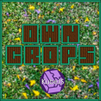

# OwnCrops

    

*Customize your Farming Experience* • [Downloads](https://github.com/Ender-Development/OwnCrops-Fabric/releases) • [CurseForge](https://www.curseforge.com/minecraft/mc-mods/owncrops-fabric) • [Modrinth](https://modrinth.com/mod/owncrops-fabric)

&nbsp;

## Introduction

OwnCrops is a Mod for Minecraft made by `Ender-Development`.

It allows Modpack Creators to add new Crops without the need of making a seperate mod for them. We utilize [KubeJS](https://github.com/KubeJS-Mods/KubeJS) by [LatvianModder](https://github.com/LatvianModder) to make the process of adding new crops for the user even easier.

We made use of [Artifice](https://github.com/natanfudge/artifice) by [Fudge](https://github.com/natanfudge) to generate the models, blockstates and loottables in this mod.

### Example

[Here](run/kubejs/startup_scripts/script.js) is a working documented example on how to use the mod.
The shown resources are located [here](run/kubejs/assets/owncrops/textures/).

## Archive Note

This project is archived as of 17th November 2026. It stays here for educational purpose only. Do not expect any further updates.
